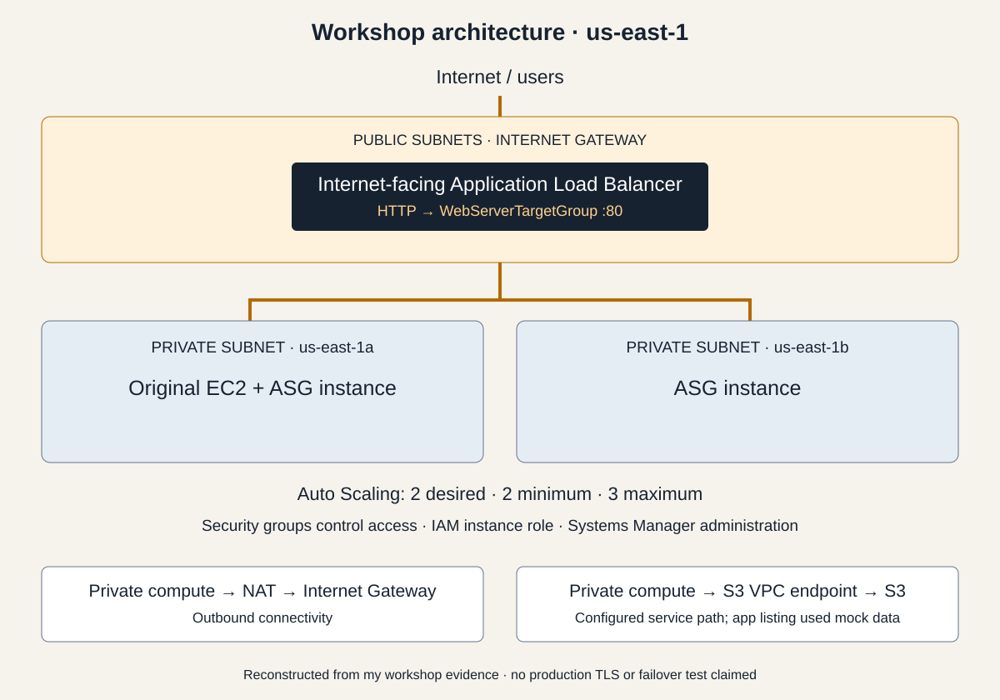

# AWS Cloud Infrastructure & Security Lab

My first hands-on AWS project, completed at **Rider University's AWS 101 workshop** in October 2026. I set up the infrastructure for a supplied web application in a temporary account and completed the optional scaling challenge.

## What I did

- Kept the application servers private, behind a public load balancer.
- Used AWS roles and Systems Manager to manage access.
- Added two servers across two AWS Availability Zones.
- Checked server health and removed the temporary infrastructure after testing.

**Verified: 3 healthy servers behind the load balancer, across 2 zones.** Two were managed by Auto Scaling; the third was the original server.

## What I learned

I practiced separating public access from private servers, managing permissions, checking system health, and cleaning up cloud resources. These are foundations I can build on in a cybersecurity internship.

I also learned to question test results: the app's S3 file list used sample data, so it did not prove a real storage connection. I configured automatic scaling but did not test it under heavy traffic. The workshop used HTTP, not HTTPS.

## Take a closer look

- [20 screenshots organized by stage](docs/evidence.md)
- [Setup and exact settings](docs/implementation.md)
- [What I tested and what remains unverified](docs/validation.md)
- [Cleanup](docs/cleanup.md)
- [My portfolio](https://freddyflores.me)

This was a guided AWS console exercise, with ChatGPT support for troubleshooting and documentation. I configured the infrastructure; I did not write the supplied application. Screenshots are cropped and sensitive identifiers are redacted. The temporary environment is no longer offered as a live demo.
