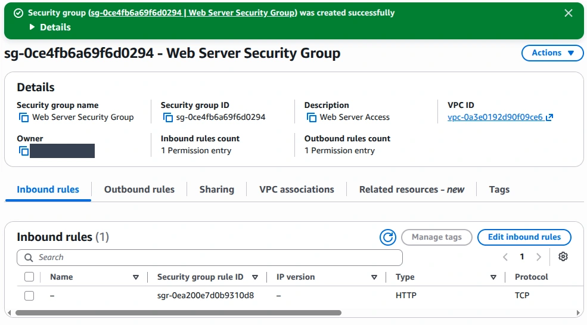
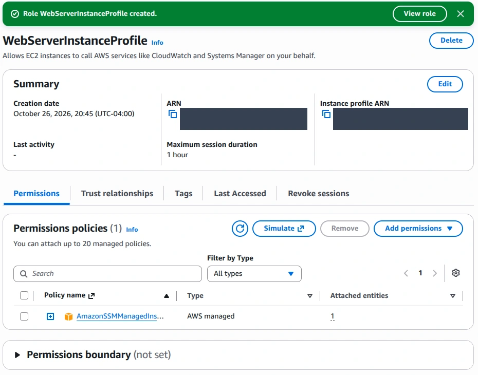
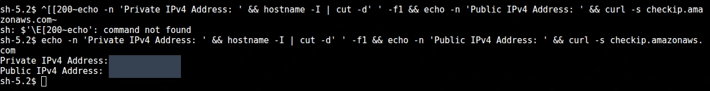
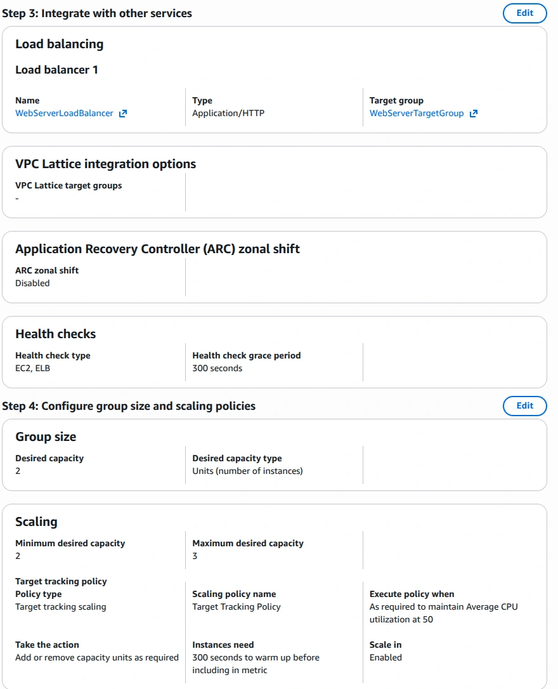
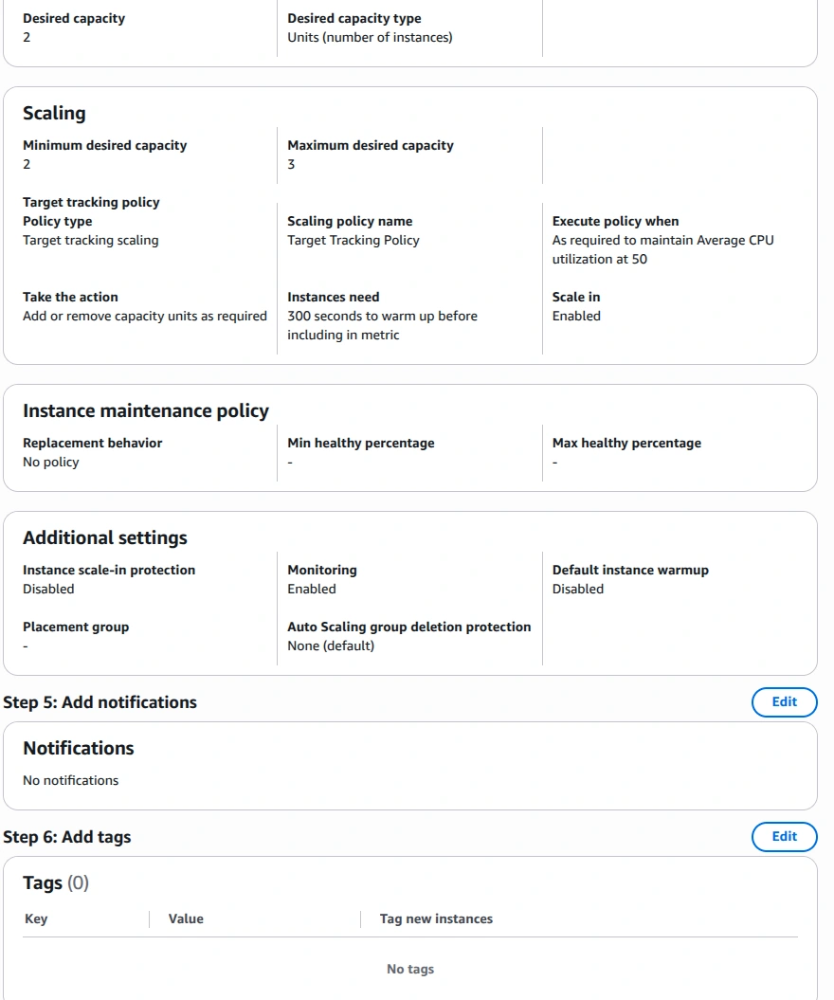
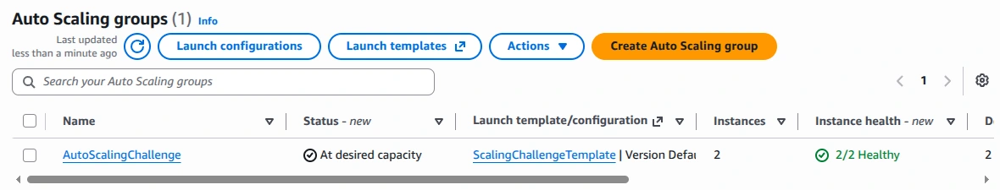
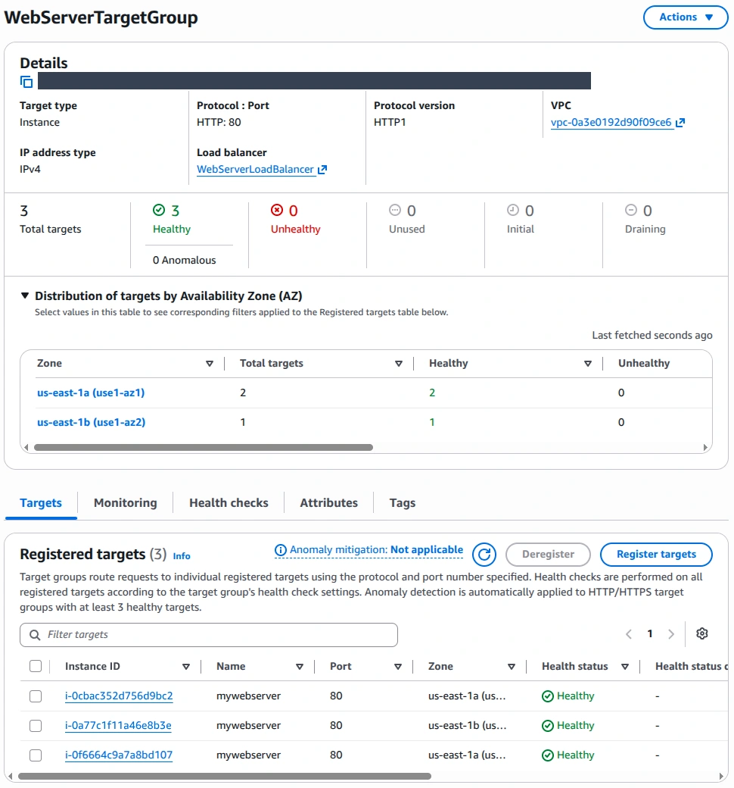
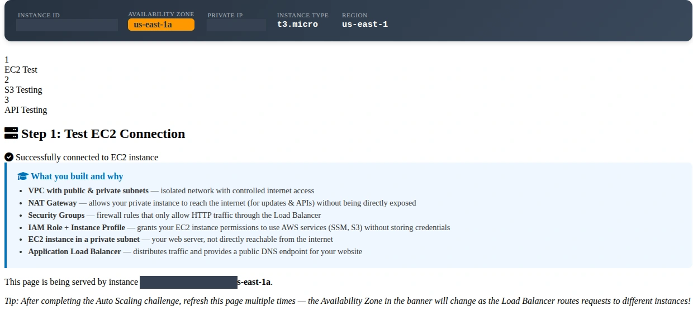
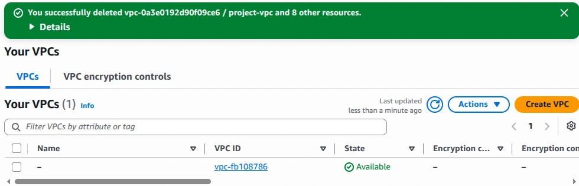
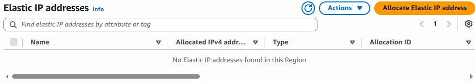

# Evidence index

Selected original captures, cropped for readability. Browser/account/session headers are removed; account identifiers, addresses and applicable ARN fields are masked. No console outcomes were generated or altered.

## Controlled network access

Source capture: `9.png`. I configured a web-server security group; the capture shows an HTTP inbound rule.

## An instance role for administration

Source capture: `12.png`. I created WebServerInstanceProfile with the Systems Manager managed policy.

## Private instance administration

Source capture: `23.png`. I opened a Systems Manager session. Address values are redacted; the public address check reflects outbound egress.

## Capacity and health checks

Source capture: `62.png`. I configured 2 desired instances, a maximum of 3, a 50% CPU target, and EC2/ELB health checks.

## Monitoring enabled

Source capture: `63.png`. I enabled group monitoring. The 300-second policy warmup is separate from default instance warmup, which was disabled.

## 2/2 Auto Scaling instances healthy

Source capture: `65.png`. I verified that the Auto Scaling group reached its desired capacity.

## 3/3 targets healthy across two zones

Source capture: `66.png`. The target group contained the original server plus two Auto Scaling instances, with no unhealthy targets.

## Application response through the load balancer

Source capture: `68.png`. I verified EC2 connectivity through the application. This capture shows a response from us-east-1a.

## Project network removed

Source capture: `Cleanup 27.png`. I confirmed deletion of project-vpc and eight associated resources; the default VPC remained.

## No remaining Elastic IPs in the region

Source capture: `Cleanup 28.png`. I checked the Elastic IP inventory in the workshop region after cleanup.

