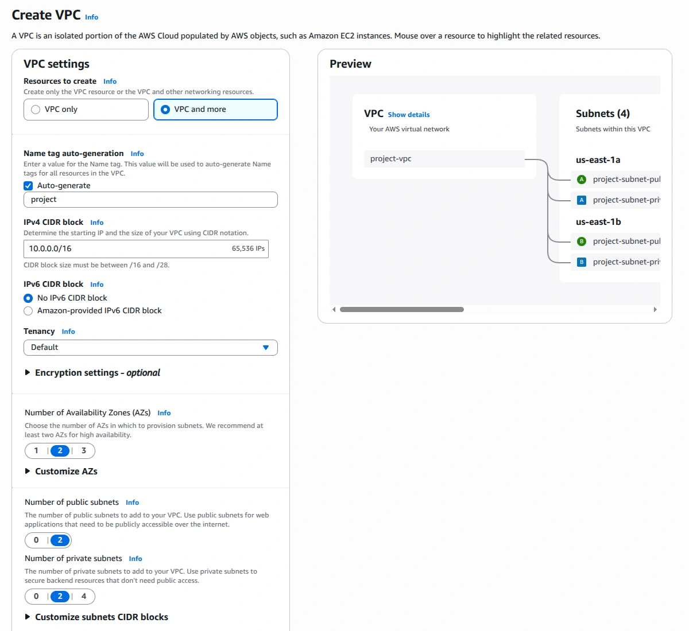
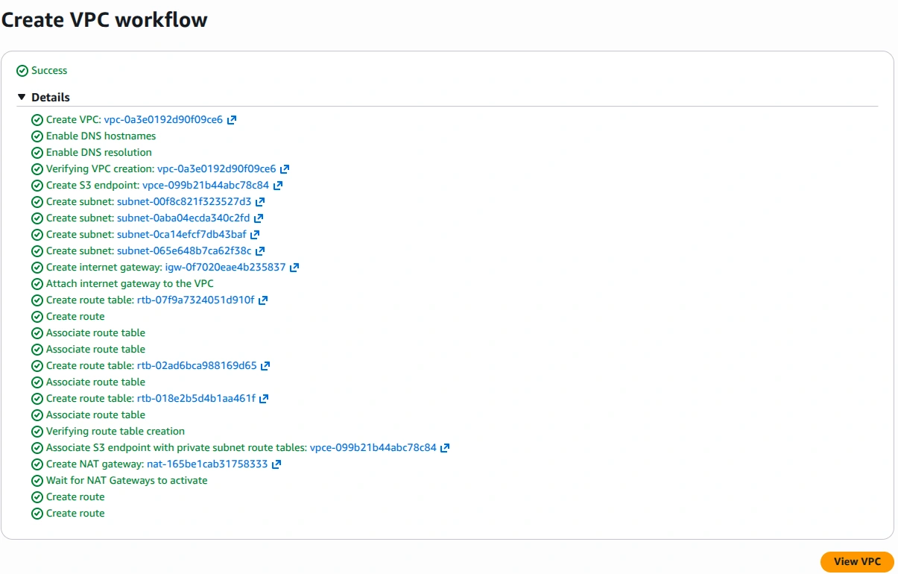
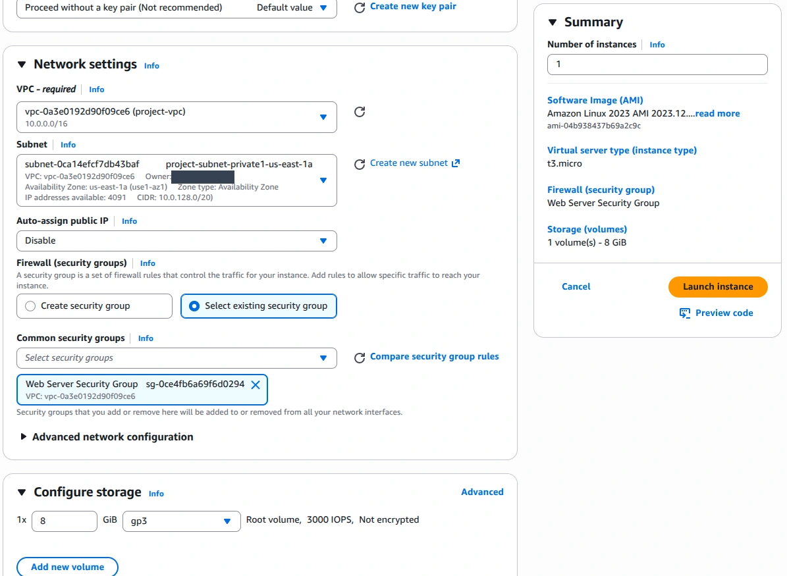
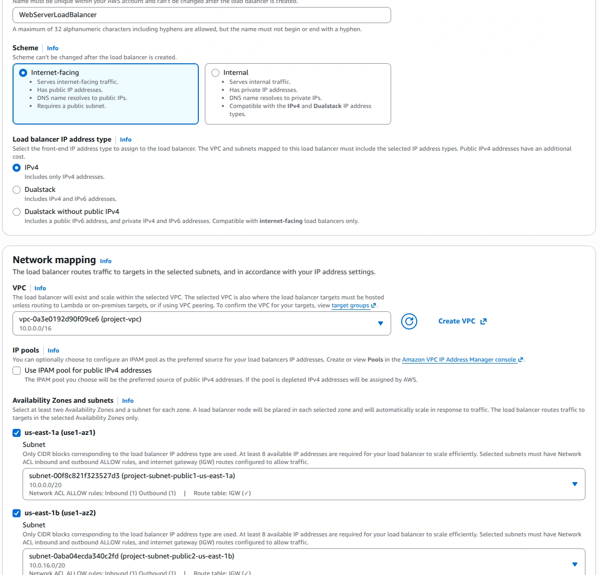
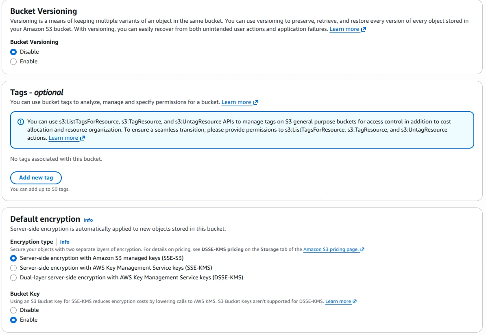
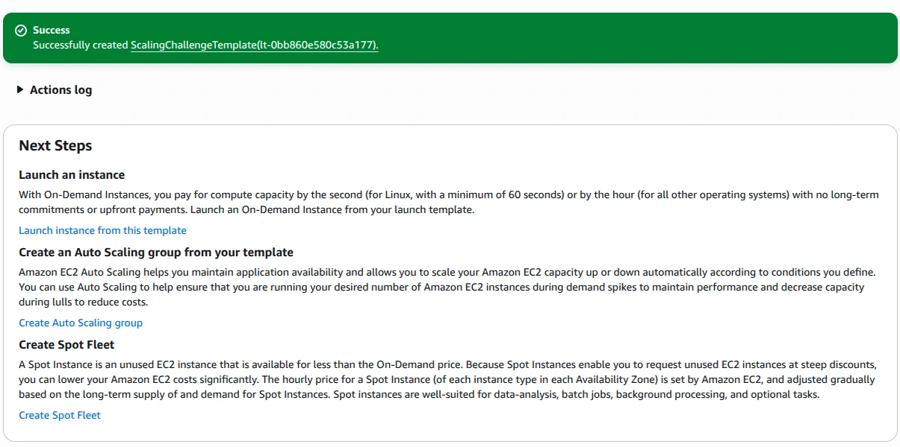
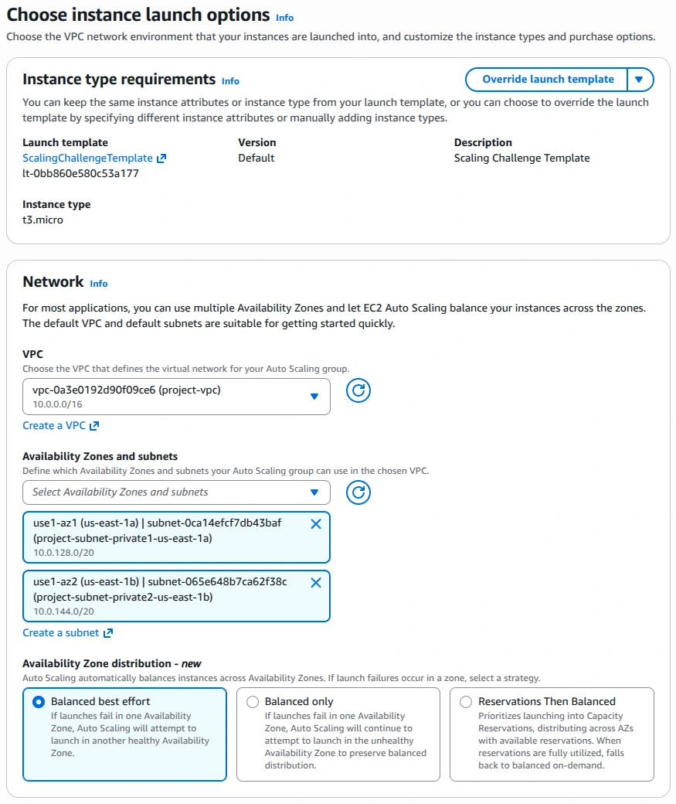
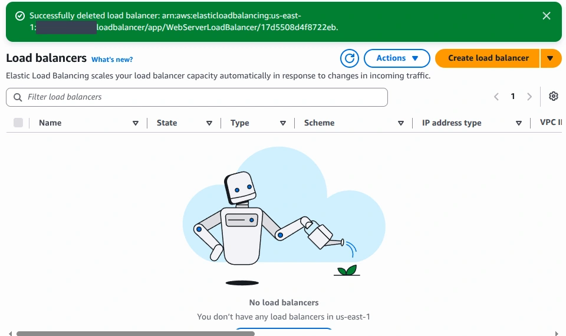
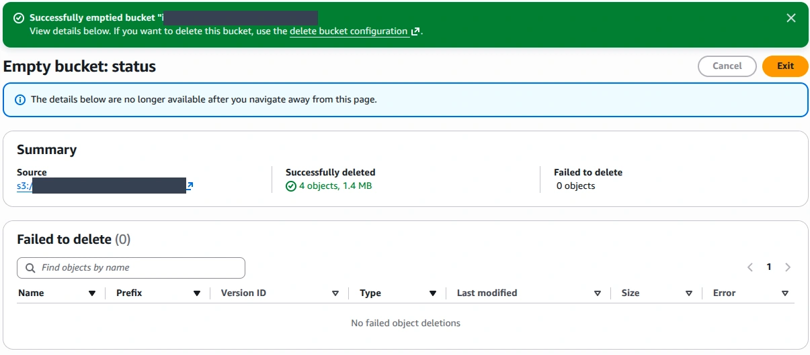
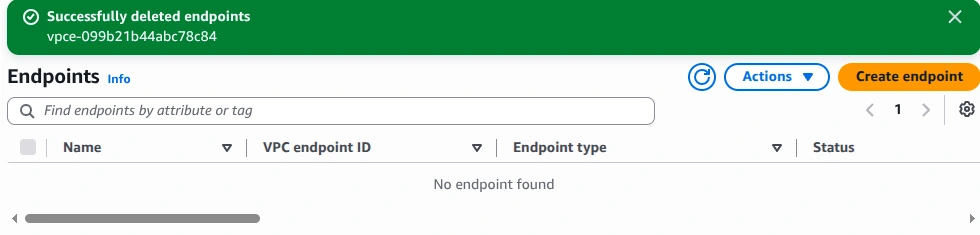

# Screenshot walkthrough

20 selected captures follow my work from setup to cleanup. Open a stage below, then click an image to inspect it at full size. The [short overview](../README.md) and [test limitations](validation.md) provide context.

Browser/account/session headers are cropped out, and sensitive values are masked. These are original screenshots, not generated console images. Setup screens show settings at that moment; success is claimed only where a result confirms it.

## 1. Network setup

View 3 screenshots

### Planning the network

Source capture: `4.png`. I selected two zones, with two public and two private subnets.

### Network creation completed

Source capture: `6.png`. The creation workflow confirmed the subnets, routes, Internet Gateway, NAT Gateway and S3 endpoint.

### Controlled network access

Source capture: `9.png`. I configured a web-server security group; the capture shows an HTTP inbound rule.

## 2. Server and access

View 3 screenshots

### Placing the server in a private subnet

Source capture: `15.png`. I disabled automatic public IP assignment and selected the web-server security group. The storage setting shown here was not encrypted; encryption is an improvement for a future build.

### An instance role for administration

Source capture: `12.png`. I created WebServerInstanceProfile with the Systems Manager managed policy.

### Private instance administration

Source capture: `23.png`. I opened a Systems Manager session. Address values are redacted; the public address check reflects outbound egress.

## 3. Load balancing and storage

View 2 screenshots

### Creating the public entry point

Source capture: `30.png`. I selected an internet-facing load balancer and public subnets in both zones.

### Choosing storage settings

Source capture: `41.png`. The bucket creation screen shows versioning disabled and S3-managed encryption selected. This is a settings capture, not a successful application storage test.

## 4. Scaling and monitoring

View 4 screenshots

### Saving the server template

Source capture: `48.png`. I created ScalingChallengeTemplate so the scaling group could launch additional servers.

### Choosing the scaling network

Source capture: `51.png`. I selected the project VPC and its two private subnets for the additional servers.

### Capacity and health checks

Source capture: `62.png`. I configured 2 desired instances, a maximum of 3, a 50% CPU target, and EC2/ELB health checks.

### Monitoring enabled

Source capture: `63.png`. I enabled group monitoring. The 300-second policy warmup is separate from default instance warmup, which was disabled.

## 5. Results

View 3 screenshots

### 2/2 Auto Scaling instances healthy

Source capture: `65.png`. I verified that the Auto Scaling group reached its desired capacity.

### 3/3 targets healthy across two zones

Source capture: `66.png`. The target group contained the original server plus two Auto Scaling instances, with no unhealthy targets.

### Application response through the load balancer

Source capture: `68.png`. I verified EC2 connectivity through the application. This capture shows a response from us-east-1a.

## 6. Cleanup

View 5 screenshots

### Removing the load balancer

Source capture: `Cleanup 12.png`. The console confirmed deletion and showed no load balancers remaining in the workshop region.

### Emptying the bucket

Source capture: `Cleanup 20 emptied.png`. The cleanup result shows four objects removed and no failed deletions. This confirms an empty bucket, not final bucket deletion.

### Removing the service endpoint

Source capture: `Cleanup 23.png`. The console confirmed endpoint deletion and showed an empty endpoint list.

### Project network removed

Source capture: `Cleanup 27.png`. I confirmed deletion of project-vpc and eight associated resources; the default VPC remained.

### No remaining Elastic IPs in the region

Source capture: `Cleanup 28.png`. I checked the Elastic IP inventory in the workshop region after cleanup.

